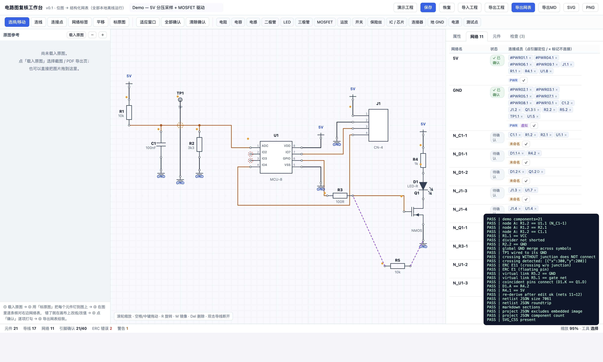

# dianlu · 电路图复核工作台

> 把「电路图位图」变成「可编辑、可复核、可导出的结构化网表」的浏览器工作台。
> 单页、纯离线、零依赖，双击 `app/index.html` 即可使用。



---

## 1. 为什么需要它

直接让视觉模型“看”原理图**不可靠**，具体风险点：

- 引脚编号 / 位号（`U3-A`、`B12`）误读
- 网络标号误读（`KL30` / `CAN_H` / `VCC_5V`）
- **交叉导线被误判为相连**（原理图最常见的歧义）
- 总线、分线、跨页连接符（off-page connector）
- 阻容值 / 型号（`100nF` vs `10nF`、`BSS138` vs `BSS123`）

而这类错误一旦流入网表，**后续的电气分析、测试用例、验证结论会全部失效**。

所以本项目的立场是：**不去追求“识别得多准”，而是让“认错的地方改起来足够便宜，并且修改可留痕、可审计”**。

输入源按可靠性递减：

| 优先级 | 输入 | 准确率 | 说明 |
|---|---|---|---|
| ★★★ | EDA 源文件 / 网表导出物 | 100% | `.kicad_sch` / `.SchDoc` / `.dsn` / `.net` 等，**完全不需要识别** |
| ★★☆ | 矢量 PDF（含文字层） | 高 | 文字与线段可带坐标抽取，远优于像素识别 |
| ★☆☆ | 位图（截图 / 照片 / 扫描件） | 中低 | 仅生成**带置信度的草稿**，必须人工复核 |

---

## 2. 快速开始

```bash
git clone https://github.com/Eason710085/dianlu.git
cd dianlu
open app/index.html        # macOS
# 或直接用浏览器打开 app/index.html
```

无需安装、无需服务器、无需联网。数据保存在浏览器 `localStorage`。

内置一个演示工程（5V 分压采样 + MOSFET 驱动），刻意包含三种典型复核场景：

1. **交叉但未加连接点** → 工具判定为“不连接”，并在 ERC 里报警（`E11`）
2. **两个悬空引脚** → `E1`
3. **虚拟连接**（原图上没画线，但逻辑上相连）→ 紫色虚线声明，而不是画一根假线

---

## 3. 功能清单

### 3.1 原图对照与定位
- 载入原图（截图 / PDF 导出页 / 拖拽）
- 缩放、平移
- **「标原图」工具**：把画布上的元件“钉”到原图对应位置，形成双向索引

### 3.2 画布编辑（真编辑器，非静态图）
- 元件：拖动 / 旋转 90° / 镜像 / 删除 / 改位号 / 改型号值
- 元件库：电阻、电容、电感、二极管、LED、三极管、MOSFET、运放、开关、保险丝、IC/芯片、连接器、地、电源、测试点
- 导线：正交折线绘制、端点吸附引脚、整段拖动、顶点拖动、**双击断开成两段**
- 连接点（junction）：新增/删除，控制十字交叉是否导通
- 网络标签：命名网络（同时参与连通性推导）
- 虚拟连接：声明“逻辑相连但图上无走线”，导出时单独标注

### 3.3 网表视图（核对主界面）
- 每条网络列出全部引脚成员，点击定位到画布
- 引脚 `×` → 标记“不连接”（生成 NC 标记，稳定可撤销）
- 网络重命名（自动补网络标签对象，而不是改一个悬空字符串）

### 3.4 复核状态（可审计）
- 每个**引脚**可标记「已确认」，网络状态由其成员聚合：`待确认 / 部分 / 已确认`
- 画布配色即状态：**琥珀色 = 待确认**，深色 = 已确认
- 元件级确认状态独立记录
- 导出时附带 `review` 统计，明确“哪些结论是人工确认过的”

### 3.5 电气规则检查（ERC）
| 代码 | 级别 | 含义 |
|---|---|---|
| `E0` | info | 仍有 N 个引脚未确认 |
| `E1` | error | 悬空引脚 / 单点网络 |
| `E2` | error | 导线未连接任何引脚 |
| `E3` | info | 网络未命名（建议加标签） |
| `E4` | error | 位号重复 |
| `E5` | error | 电源域混接（同一网络多个电源名） |
| `E6` | error | 驱动冲突（一个网络多个输出引脚） |
| `E7` | error | 命名冲突（同一网络多个名称） |
| `E8` | error | 电源/地符号孤立 |
| `E10` | info | 网络含虚拟连接 |
| **`E11`** | **warn** | **十字交叉未加连接点（已按“不连接”处理）** |

`E11` 是对本场景最有价值的一条：它把原图上最容易读错、也最容易出事故的位置主动圈出来。

### 3.6 导入 / 导出
| 动作 | 格式 | 用途 |
|---|---|---|
| 保存 / 恢复 | localStorage | 本地断点 |
| 导出工程 | `*.schematic.json` | 完整可还原（含坐标、状态、虚拟连接；不含内嵌图片） |
| **导出网表** | `*.netlist.json` | **机器可读，给下游分析/验证用** |
| 导出 MD | `*.netlist.md` | 人工评审、贴进报告 |
| 导出 SVG / PNG | 图片 | 汇报、归档 |

---

## 4. 数据模型

连通性**从几何推导**（这是与普通画图工具的本质区别）：

- 同坐标合并
- 导线端点落在另一导线内部 → **T 型自动连接**
- 十字交叉 → **只有存在连接点才导通**，否则报 `E11`
- 同名的地 / 电源符号 → 全局合并
- 网络标签 → 参与合并并命名
- 虚拟连接 → 逻辑合并

导出的网表结构（`examples/demo.netlist.json` 为真实产物）：

```json
{
  "meta": { "name": "...", "tool": "schematic-bench/0.1", "status": "draft（位图识别 + 人工复核）" },
  "stats": { "comps": 21, "wires": 17, "nets": 11, "pins": 40, "checkedPins": 21 },
  "components": [
    { "ref": "U1", "kind": "ic", "part": "MCU-8", "checked": false,
      "pins": [{ "num": "1", "name": "ADC", "role": "unknown" }] }
  ],
  "nets": [
    { "name": "5V", "status": "checked", "power": ["5V"], "members": ["#PWR01.1", "R1.1", "U1.8"] }
  ],
  "links": [{ "from": "R5.1", "to": "R3.2", "note": "识别缺失：R5 实为栅极下拉" }],
  "erc": [{ "level": "warn", "code": "E11", "msg": "十字交叉未加连接点 @(300,200)…" }],
  "review": { "pinsTotal": 40, "pinsChecked": 21, "notConnectedPins": [] }
}
```

这份 JSON 可直接映射为 KiCad 网表 / SPICE / 图结构（见 [docs/04-plan.md](docs/04-plan.md)）。

---

## 5. 目录结构

```
dianlu/
├── README.md
├── app/                          # 可运行原型（纯前端，无构建）
│   ├── index.html                # 入口，双击打开
│   ├── model.js                  # 符号库 + 连通性推导 + ERC + 导出
│   ├── render.js                 # SVG 画布 / 表格 / 检查面板渲染
│   ├── app.js                    # 交互、导入导出、内置自检
│   └── style.css                 # 界面样式
├── docs/
│   ├── 01-context-and-requirements.md   # 背景、需求、约束、决策
│   ├── 02-conversation-log.md           # 三轮问答的结构化记录
│   ├── 03-open-source-landscape.md      # 开源生态调研
│   ├── 04-plan.md                       # 下一步方案与里程碑
│   ├── 05-image-reading-protocol.md     # 位图读图协议
│   └── preview.png
└── examples/
    ├── demo.netlist.json         # 导出的机器可读网表
    └── demo.netlist.md           # 导出的人工可读网表
```

---

## 6. 质量保证

内置自检（`app/index.html?selftest=1`），覆盖 **25 项**，包括：

- 分压节点连通性、地/电源全局合并
- **交叉无连接点不导通**、T 型连接导通
- 重合引脚直连、虚拟连接合并
- 编辑后重算网表
- 网表 JSON 往返、工程 JSON 不含内嵌图片

```bash
# 无头浏览器跑一遍（macOS + Chrome）
"/Applications/Google Chrome.app/Contents/MacOS/Google Chrome" --headless=new --dump-dom \
  "file://$PWD/app/index.html?selftest=1" | grep -o 'SELFTEST-[A-Z]* [0-9/]*'
# 期望：SELFTEST-PASS 25/25
```

---

## 7. 路线图

| 阶段 | 内容 | 状态 |
|---|---|---|
| v0.1 | 可编辑画布 + 网表视图 + ERC + 状态化复核 + 导出 | ✅ 已完成 |
| v0.2 | **导出 `.kicad_sch`**（进 EDA 生态，可被 KiCanvas 渲染） | 待做 |
| v0.3 | 矢量 PDF 自动抽取（`pdfplumber` / `PyMuPDF`：文字层 + 线段 → 初稿网表） | 待做 |
| v0.4 | 接 `circuitgraph` 做更深层电气检查；对齐 KiCad ERC 规则集 | 待做 |
| v0.5 | 位图初稿辅助（符号检测 + OCR），只作为 seed，必须人工复核 | 待做 |

详见 [docs/04-plan.md](docs/04-plan.md)。

---

## 8. 开源生态

结论：**第②层（编辑/格式）与第③层（网表分析）已有成熟开源可用；第①层（位图→工程级网表）只有学术原型。**

KiCad / KiCanvas / QElectroTech / tscircuit / netlistsvg / circuitgraph / SPICEnet / CircuitVision 等评估见
[docs/03-open-source-landscape.md](docs/03-open-source-landscape.md)。

---

## 9. 仓库维护

`origin` 拉取地址为 HTTPS（`https://github.com/Eason710085/dianlu.git`），
本机推送走 SSH（已配置 ed25519 key，避免明文 token）：

```bash
git remote -v
# origin  https://github.com/Eason710085/dianlu.git (fetch)
# origin  git@github.com:Eason710085/dianlu.git (push)

git add -A && git commit -m "..." && git push
```

换一台机器时：拉取无需认证（公开仓库），推送需配置 SSH key 或使用 PAT。

---

## 10. 说明

- 本仓库为**通用技术方案与工具**，不包含任何公司内部资料。
- 位图识别产物一律标记为 **draft**，`low` 置信项不参与任何验证结论。
- License：暂未指定，如需对外分发请先补充 LICENSE。
